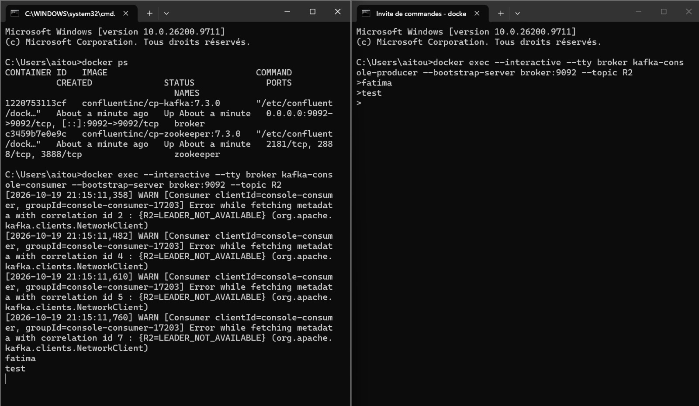
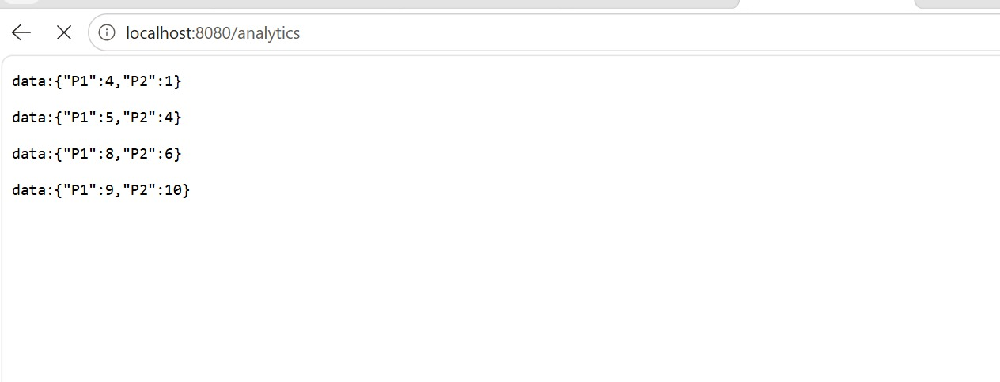
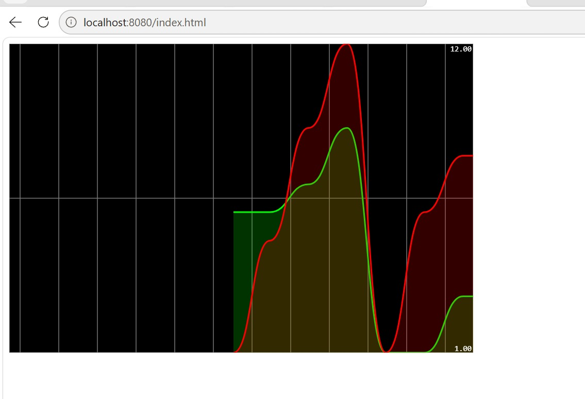

# Activité Pratique N°3 – Event Driven Architecture (EDA)

> **Module :** Systèmes distribués – GLSID 3, ENSET Mohammedia
> **Enseignant :** M. Mohamed YOUSSFI
> **Réalisé par :** Fatima AITOULAHYAN

---

## 1. Objectif

Comprendre et mettre en pratique les **architectures pilotées par les événements** avec **Apache Kafka** :

- installer et démarrer **Zookeeper** et **Kafka** (via Docker) ;
- tester la production et la consommation de messages avec `kafka-console-producer` et `kafka-console-consumer` ;
- développer une application **Spring Boot** avec **Spring Cloud Stream** qui produit, consomme et traite des événements ;
- réaliser un traitement temps réel avec **Kafka Streams** (comptage de visites de pages par fenêtre de 5 secondes) ;
- exposer les résultats en flux continu (**Server-Sent Events**) et les afficher dans un **tableau de bord temps réel**.

### Ressources

- Cours : <https://www.youtube.com/watch?v=6O5dQi3l-hU>
- Vidéo de la partie pratique : <https://www.youtube.com/watch?v=8uY7JE_X_Fw>

---

## 2. Architecture

```
┌──────────────┐   GET /publish?name=P1&topic=R2   ┌────────────────────────┐
│  Navigateur  │ ─────────────────────────────────▶│  PageEventController   │
└──────────────┘                                   │  (StreamBridge)        │
       ▲                                           └───────────┬────────────┘
       │ SSE  GET /analytics                                   │ PageEvent (JSON)
       │                                                       ▼
┌──────┴───────┐        ┌─────────────────────────────────────────────────┐
│ index.html   │        │                 Apache Kafka (topic R2)          │
│ (courbes     │        └───────┬──────────────────────────┬──────────────┘
│  temps réel) │                │                          │
└──────────────┘                ▼                          ▼
                     ┌────────────────────┐    ┌──────────────────────────┐
                     │ pageEventConsumer  │    │ kStream (Kafka Streams)  │
                     │ (affiche en console)│   │ fenêtre 5 s + count()    │
                     └────────────────────┘    │ store : "count-store"    │
                                               └────────────┬─────────────┘
                                                            │ interactive query
                                                            ▼
                                               /analytics (InteractiveQueryService)
```

| Composant | Rôle |
|---|---|
| `PageEvent` | Record représentant un événement de visite de page |
| `PageEventController` | Publie des événements (`/publish`) et diffuse les statistiques (`/analytics`) |
| `PageEventHandler` | Définit le `Consumer`, le `Supplier` et la fonction Kafka Streams |
| `count-store` | State store fenêtré qui contient le nombre d'événements par page |
| `index.html` | Tableau de bord affichant les compteurs en temps réel |

---

## 3. Technologies

- Java 17+
- Spring Boot, Spring Web, Spring WebFlux (`Flux`)
- Spring Cloud Stream (+ binder **Kafka** et **Kafka Streams**)
- Apache Kafka / Zookeeper – images Docker `confluentinc/cp-kafka:7.3.0` et `confluentinc/cp-zookeeper:7.3.0`
- Docker Desktop
- Maven

---

## 4. Partie 1 – Démarrer Kafka avec Docker

### 4.1 Docker Compose

Fichier `docker-compose.yml` (exemple de configuration à adapter) :

```yaml
version: '3'
services:
  zookeeper:
    image: confluentinc/cp-zookeeper:7.3.0
    container_name: zookeeper
    environment:
      ZOOKEEPER_CLIENT_PORT: 2181
      ZOOKEEPER_TICK_TIME: 2000

  broker:
    image: confluentinc/cp-kafka:7.3.0
    container_name: broker
    ports:
      - "9092:9092"
    depends_on:
      - zookeeper
    environment:
      KAFKA_BROKER_ID: 1
      KAFKA_ZOOKEEPER_CONNECT: zookeeper:2181
      KAFKA_LISTENER_SECURITY_PROTOCOL_MAP: PLAINTEXT:PLAINTEXT,PLAINTEXT_HOST:PLAINTEXT
      KAFKA_ADVERTISED_LISTENERS: PLAINTEXT://broker:29092,PLAINTEXT_HOST://localhost:9092
      KAFKA_OFFSETS_TOPIC_REPLICATION_FACTOR: 1
```

### 4.2 Lancement et vérification

```bash
docker compose up -d
docker ps
```

Deux conteneurs doivent être à l'état **Up** :

| Conteneur | Image | Ports |
|---|---|---|
| `broker` | `confluentinc/cp-kafka:7.3.0` | `9092` |
| `zookeeper` | `confluentinc/cp-zookeeper:7.3.0` | `2181`, `2888`, `3888` |

---

## 5. Partie 2 – Test avec console producer / consumer

**Terminal 1 – Consumer** (topic `R2`) :

```bash
docker exec --interactive --tty broker kafka-console-consumer --bootstrap-server broker:9092 --topic R2
```

**Terminal 2 – Producer** :

```bash
docker exec --interactive --tty broker kafka-console-producer --bootstrap-server broker:9092 --topic R2
>fatima
>test
```

Les messages `fatima` et `test` saisis dans le producer apparaissent dans le consumer.

> ℹ️ Les avertissements `LEADER_NOT_AVAILABLE` affichés au démarrage du consumer sont **normaux** : le topic `R2` est créé automatiquement à la première utilisation et le leader de la partition n'est pas encore élu. Ils disparaissent dès que le topic est prêt.



---

## 6. Partie 3 – Application Spring Boot

### 6.1 L'événement : `PageEvent`

```java
public record PageEvent(
        String name,
        String user,
        Date date,
        long duration
) {}
```

### 6.2 Les handlers : `PageEventHandler`

| Bean | Type | Description |
|---|---|---|
| `pageEventConsumer` | `Consumer<PageEvent>` | Consomme les événements et les affiche dans la console |
| `pageEventSupplier` | `Supplier<PageEvent>` | Génère périodiquement un événement aléatoire (page `P1`/`P2`, utilisateur `U1`/`U2`, durée aléatoire) |
| `kStream` | `Function<KStream<String, PageEvent>, KStream<String, Long>>` | Traitement Kafka Streams : clé = nom de la page, regroupement, fenêtre de **5 secondes**, `count()` matérialisé dans `count-store` |

Traitement Kafka Streams :

```java
stream
    .map((k, v) -> new KeyValue<>(v.name(), 0L))
    .groupByKey(Grouped.with(Serdes.String(), Serdes.Long()))
    .windowedBy(TimeWindows.ofSizeWithNoGrace(Duration.ofSeconds(5)))
    .count(Materialized.as("count-store"))
    .toStream()
    .map((k, v) -> new KeyValue<>(k.key(), v));
```

### 6.3 Le contrôleur : `PageEventController`

| Endpoint | Description |
|---|---|
| `GET /publish?name=P1&topic=R2` | Crée un `PageEvent` (utilisateur `U1` ou `U2` tiré au hasard, durée aléatoire) et l'envoie dans le topic via `StreamBridge` |
| `GET /analytics` | Flux **SSE** (`text/event-stream`) : toutes les secondes, interroge le store `count-store` (fenêtre des 5 dernières secondes) via `InteractiveQueryService` et renvoie `{page: nombre}` |

---

## 7. Exécution et résultats

### 7.1 Publier un événement

```
http://localhost:8080/publish?name=P1&topic=R2
```

Réponse JSON :

```json
{
  "name": "P1",
  "user": "U2",
  "date": "2026-10-19T21:47:20.663Z",
  "duration": 391
}
```

Le même événement est reçu par le `kafka-console-consumer` : l'événement transite bien par Kafka.


### 7.2 Analyse en temps réel (SSE)

```
http://localhost:8080/analytics
```

Le navigateur reçoit un flux continu du nombre de visites par page sur la fenêtre glissante de 5 secondes :

```
data:{"P1":4,"P2":1}
data:{"P1":5,"P2":4}
data:{"P1":8,"P2":6}
data:{"P1":9,"P2":10}
```



### 7.3 Tableau de bord temps réel

```
http://localhost:8080/index.html
```

Les courbes rouge (`P2`) et verte (`P1`) se mettent à jour en continu à partir du flux `/analytics`.



---

## 8. Lancer le projet

1. Démarrer Docker Desktop puis exécuter `docker compose up -d`.
2. Lancer l'application Spring Boot :
   ```bash
   mvn spring-boot:run
   ```
3. Ouvrir `http://localhost:8080/index.html` pour le dashboard.
4. Générer du trafic en appelant plusieurs fois :
   - `http://localhost:8080/publish?name=P1&topic=R2`
   - `http://localhost:8080/publish?name=P2&topic=R2`

---

## 9. Concepts illustrés

- **Architecture pilotée par les événements** : producteurs et consommateurs découplés via un broker.
- **Topic Kafka** comme canal de communication asynchrone.
- **Spring Cloud Stream** : programmation fonctionnelle (`Supplier`, `Consumer`, `Function`) et `StreamBridge` pour l'envoi à la demande.
- **Kafka Streams** : traitement de flux avec agrégation fenêtrée (*windowing*) et état local (*state store*).
- **Interactive Queries** : lecture du state store depuis l'application.
- **Server-Sent Events** : diffusion temps réel vers le navigateur.

---

## 10. Conclusion

Cette activité a permis de mettre en place une chaîne complète d'événements : de la publication d'un message dans Kafka jusqu'à sa visualisation temps réel dans le navigateur, en passant par un traitement analytique avec Kafka Streams.
